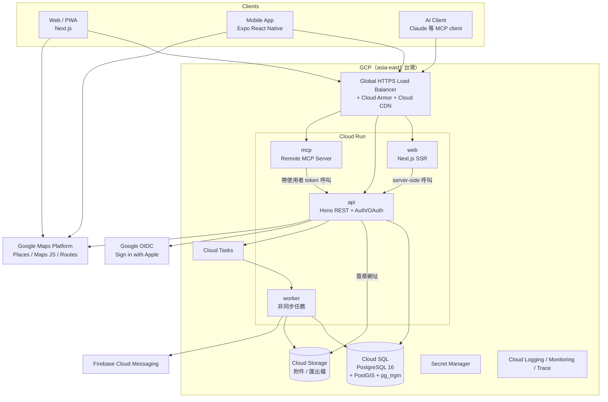
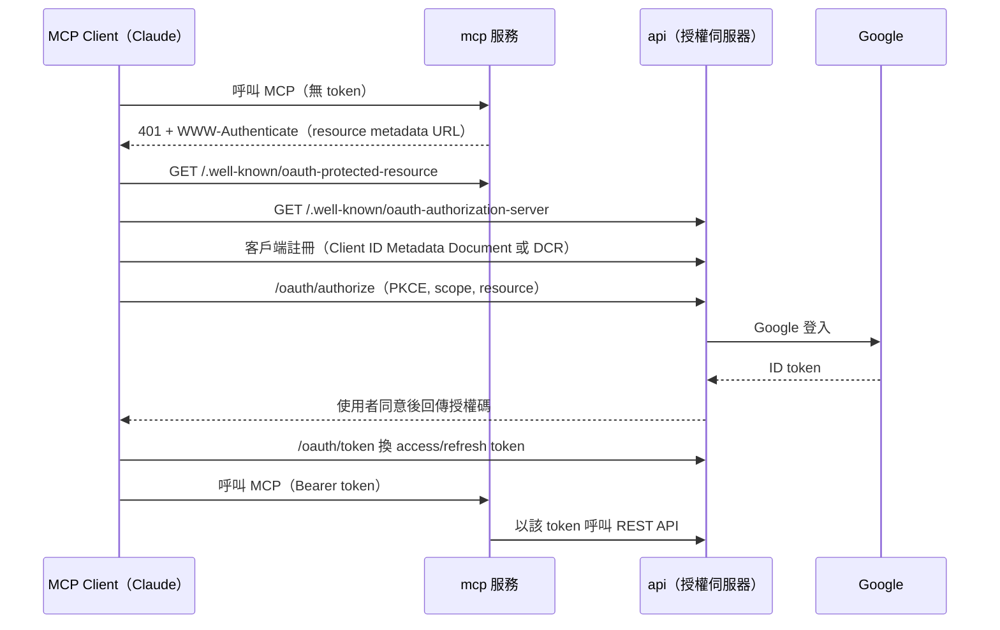
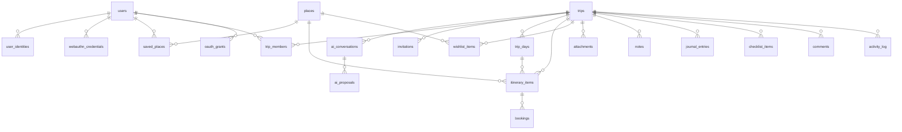
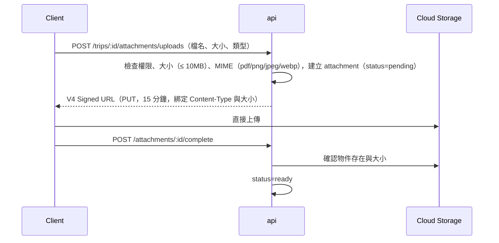
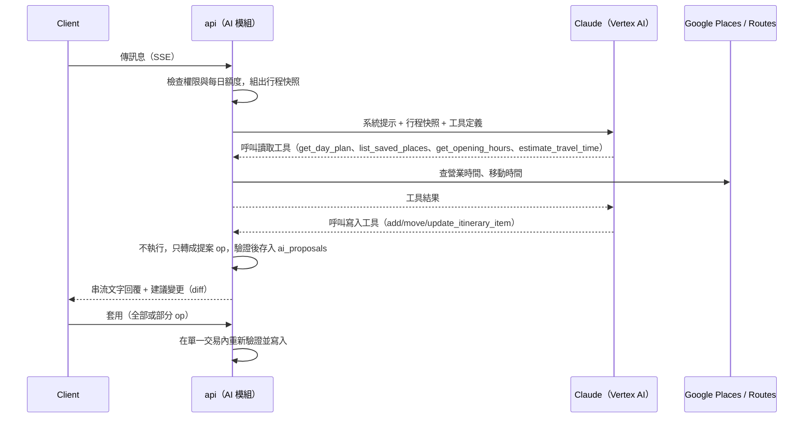

# Travelog 系統架構設計

> 版本：v0.2（草案）｜日期：2026-11-21｜對應：[PRD.md](./PRD.md)
>
> v0.2 變更：身分提供者加入 Apple；移除照片處理管線（保留附件上傳），相關設計移到 §14 未來擴充。
> v0.3 變更：加入 Passkey（WebAuthn）登入（§4.2.3）；新增確定（釘選）行程點的資料模型與伺服器端鎖定規則（§5.5）。
> v0.6 變更：實作 M1／M2 與 Web 前端——地點代理與快取（§5.6）、想去清單、我的地點庫、成員與邀請 API；新增本機沙盒（§10.2）。尚未實作：邀請信寄送（目前以 Mailer 介面記錄）、Routes API 移動時間、即時同步。
> v0.5 變更：API 實作同步——行程點列表與訂位新增端點、測試環境（§7、§10.2）。
> v0.4 變更：新增我的地點庫（§5.6）；新增 App 內 AI 行程助理（§8.2），與 MCP 共用工具定義（`packages/tools`）；本機開發改用本機安裝的 PostgreSQL，不使用 Docker（§10.2）。

---

## 1. 設計原則

1. **一個 API，多個入口**：Web、行動 App、MCP Server 都透過同一套後端 API 與權限邏輯存取資料，避免三套商業邏輯。
2. **自己掌握身分與權杖**：Google、Apple 當身分提供者（IdP），Passkey 由後端自己驗證；不論用哪種方式登入，都由後端簽發自己的 access / refresh token。這讓 Web、App、MCP（需要 OAuth 2.1 授權伺服器）能共用一套機制。
3. **單一語言 Monorepo**：全端 TypeScript，Web / App / API / MCP 共用型別與驗證 schema。
4. **Serverless 優先**：GCP Cloud Run 為主，流量小時成本趨近於零，不需維運 VM 或 Kubernetes。
5. **先簡單、可演進**：MVP 用 PostgreSQL 一個資料庫解決關聯、全文搜尋、地理查詢；即時同步、向量搜尋等等需要時再加。

---

## 2. 整體架構



### 2.1 服務切分

| 服務     | 技術                                                          | 職責                                                                                                             |
| -------- | ------------------------------------------------------------- | ---------------------------------------------------------------------------------------------------------------- |
| `web`    | Next.js（App Router）on Cloud Run                             | 網站 UI、公開遊記 SSR（SEO）、PWA                                                                                |
| `api`    | Node.js + Hono + Drizzle ORM on Cloud Run                     | REST API、權限、Passkey / Google / Apple 登入、OAuth 2.1 授權伺服器（給 MCP）、附件上傳簽章、AI 行程助理（§8.2） |
| `mcp`    | `@modelcontextprotocol/sdk`（Streamable HTTP）on Cloud Run    | 將 API 包成 MCP tools/resources，使用使用者的 access token 呼叫 `api`                                            |
| `worker` | Node.js on Cloud Run（由 Cloud Tasks / Cloud Scheduler 觸發） | 邀請 Email、推播、匯出 PDF、清理過期邀請、刷新地點快取。MVP 若任務很少，可先併在 `api` 內，之後再拆出            |
| `mobile` | Expo（React Native）                                          | iOS / Android App，Phase 3                                                                                       |

> 為什麼 `api` 不直接用 Next.js API Routes？因為 App 和 MCP 也要用同一套 API，獨立服務的邊界比較清楚，也能獨立擴展與部署。Next.js 只負責呈現。

---

## 3. Monorepo 結構

```
travelog/
├── apps/
│   ├── web/          # Next.js
│   ├── api/          # Hono REST API + auth
│   ├── mcp/          # MCP server
│   ├── worker/       # 背景任務
│   └── mobile/       # Expo（Phase 3）
├── packages/
│   ├── schema/       # zod schema：API 輸入輸出、共用型別（單一真相來源）
│   ├── db/           # Drizzle schema、migrations
│   ├── domain/       # 純商業邏輯（權限判斷、時區、排序、確定行程點鎖定）
│   ├── tools/        # 行程操作工具定義（名稱、說明、zod 輸入 schema、讀/寫分類），MCP 與 App 內 AI 共用
│   ├── api-client/   # 由 OpenAPI 產生的型別安全 client（web / mobile / mcp 共用）
│   └── ui/           # 共用 UI 元件（web 為主，部分可共用到 mobile）
├── infra/
│   └── terraform/    # GCP 資源
├── docs/
└── .github/workflows/
```

工具：pnpm workspaces + Turborepo、TypeScript strict、Vitest、Playwright（E2E）、Biome 或 ESLint + Prettier。

---

## 4. 身分驗證與授權

### 4.1 統一的權杖模型

- **身分來源**：
  - Google OIDC（`openid email profile`）。
  - Sign in with Apple（`name email`）。
  - Passkey（WebAuthn / FIDO2），由 `api` 擔任 Relying Party 自行驗證。
  - Google / Apple：後端驗證 IdP 的 ID token（簽章、`iss`、`aud`、`exp`、`nonce`）後，以 `(provider, sub)` 查 `user_identities`，對應到 `users`。
  - Passkey：以 credential ID 查 `webauthn_credentials`，對應到 `users`。
  - 一個使用者可以同時有多個 Google/Apple 身分與多把 Passkey。
- **後端簽發**：
  - Access token：JWT（ES256），效期 15 分鐘，含 `sub`、`scope`、`client_id`。
  - Refresh token：不透明隨機字串，雜湊後存 DB，可輪替、可撤銷，效期 30–90 天。
- **簽章金鑰**：存在 Secret Manager（或 Cloud KMS），公開金鑰以 `/.well-known/jwks.json` 提供。

### 4.2 三種入口的登入流程

| 入口              | 流程                                                                                                                                                                                                                                                                                                                              |
| ----------------- | --------------------------------------------------------------------------------------------------------------------------------------------------------------------------------------------------------------------------------------------------------------------------------------------------------------------------------- |
| Web               | 瀏覽器導向 `api` 的 `/auth/{google\|apple}` → 授權碼流程（PKCE + state + nonce）→ `api` 寫入 HttpOnly、Secure、SameSite=Lax 的 session cookie（內含 refresh token），Next.js 伺服器端以 cookie 換 access token 呼叫 API。Apple 在要求 name/email 時以 `response_mode=form_post` 回呼，回呼端點需接受跨站 POST（以 state 防 CSRF） |
| Mobile            | iOS：原生 Apple 登入（`expo-apple-authentication`）或 Google Sign-In；Android：Google Sign-In，Apple 走網頁流程。取得 ID token（Apple 另有 authorization code）→ `POST /auth/{provider}/native` 換取 access + refresh token → 存入 Keychain / Keystore                                                                            |
| MCP               | MCP client 依 MCP 授權規範走 OAuth 2.1：讀取 `mcp` 的 Protected Resource Metadata（RFC 9728）→ 找到授權伺服器 `api` → 授權碼 + PKCE → 使用者在 `api` 的登入頁以 Passkey、Google 或 Apple 登入、選擇授權範圍 → client 取得綁定 `mcp` 資源（audience）的 token                                                                      |
| Passkey（Web）    | 登入頁載入時呼叫 `POST /auth/passkey/login/options` 取得 challenge，以 `navigator.credentials.get({ mediation: "conditional" })` 支援自動填入；按「使用 Passkey 登入」則走一般 modal 流程 → `POST /auth/passkey/login/verify` → 寫入 session cookie                                                                               |
| Passkey（Mobile） | 透過原生 Passkey 模組（如 `react-native-passkey`）呼叫系統 API，流程與 Web 相同，最後換取 access + refresh token                                                                                                                                                                                                                  |

### 4.2.3 Passkey（WebAuthn）實作

- **函式庫**：`@simplewebauthn/server`（後端）、`@simplewebauthn/browser`（Web）。
- **RP ID**：使用根網域（如 `travelog.app`），讓 `app.`、`api.` 等子網域共用同一把 Passkey。實作前確定正式網域，之後很難更改（換 RP ID 等於所有 Passkey 失效）。
- **註冊選項**：`residentKey: "required"`（可探索憑證，才能免輸入帳號登入）、`userVerification: "preferred"`、`attestation: "none"`；`excludeCredentials` 帶入該使用者已有的憑證，避免重複註冊。
- **Challenge**：隨機 32 bytes、效期 5 分鐘、單次使用；存在短效資料表或簽章的 HttpOnly cookie。
- **驗證**：檢查 origin、RP ID hash、challenge、簽章；更新 `sign_count`（計數倒退時記錄警示，但同步型 Passkey 計數常為 0，不以此拒絕登入）與 `last_used_at`。
- **只能登入，不能註冊**：`/auth/passkey/register/*` 必須帶已登入的 session（第一方 client），未登入呼叫一律 401。新使用者必須先以 Google 或 Apple 建立帳號，因此每個帳號都有已驗證的 email。user handle 為隨機 64 bytes（不使用 email），在帳號建立時產生。
- **不做兩步驟驗證**：Passkey 本身是「裝置持有 + 生物辨識/PIN」的雙因素，且具防釣魚特性；Google/Apple 登入也已有各自的兩步驟驗證，因此不在其後再要求 Passkey。
- **App 關聯網域**：iOS 需在網站提供 `/.well-known/apple-app-site-association`（`webcredentials`），Android 需提供 `/.well-known/assetlinks.json`（`get_login_creds`），由 `web` 服務提供。
- **帳號復原**：Passkey 遺失時直接用 Google / Apple 登入即可，再重新新增 Passkey。刪除身分時，帳號至少要保留一個 Google 或 Apple 身分。

### 4.2.1 Sign in with Apple 實作注意事項

- **Apple Developer 設定**：需要 App ID（iOS 原生）與 Services ID（Web / Android 網頁流程），兩者的 `aud` 不同，後端都要接受。
- **Client secret**：Apple 的 client secret 是用 `.p8` 私鑰簽出的 JWT（效期最長 6 個月）。私鑰放 Secret Manager，由 `api` 動態產生並快取，不要手動輪替。
- **使用者姓名只給一次**：Apple 只在使用者第一次授權時回傳 `name`，必須當下存下來。
- **隱藏 email**：使用者可選擇 `@privaterelay.appleid.com` 轉寄信箱。要寄信到這種信箱，需在 Apple Developer 後台登錄寄件網域並設定 SPF/DKIM。
- **撤銷**：使用者刪除帳號時，以 Apple 的 refresh token 呼叫 `/auth/revoke`（App Store 要求），因此登入時要用 authorization code 換 Apple 的 refresh token，加密後存放。
- **伺服器通知**：設定 Apple 的 server-to-server notification 端點，處理使用者撤銷授權、更改 email 轉寄設定等事件。

### 4.2.2 帳號連結策略

- **不依 email 自動合併帳號**：Apple 可能是轉寄信箱，Google 與 Apple 的 email 也不一定相同，自動合併有被冒用的風險。
- 已登入的使用者可在「設定 → 登入方式」再綁定另一個提供者（需完成該提供者的登入流程）。
- 若新登入的身分 email 和既有帳號相同（且雙方 `email_verified`），只在登入後提示「是否要連結到既有帳號」，由使用者確認並重新驗證既有身分後才合併。



> MCP 授權規範仍在演進（客戶端註冊方式從 DCR 走向 Client ID Metadata Documents），實作時以當下最新版規範為準，建議兩者都支援。

### 4.3 OAuth Scope

| Scope           | 說明                        |
| --------------- | --------------------------- |
| `trips:read`    | 讀取使用者所屬的行程        |
| `trips:write`   | 新增/修改行程點、地點、清單 |
| `journal:write` | 新增心得、筆記              |

Web 與 App 的第一方 client 預設取得全部 scope；MCP client 由使用者在同意頁勾選。

### 4.4 資源層級授權

- 每個 request 都在 `domain` 層呼叫 `assertTripRole(userId, tripId, minRole)`，權限矩陣定義於 PRD 3.3。
- 所有查詢都必須以 `trip_id` 過濾，不允許只用物件 ID 取資料（防止 IDOR）。
- 可選：在 PostgreSQL 開啟 Row Level Security 作為第二道防線（以 `SET LOCAL app.user_id` 傳入）。

### 4.5 邀請流程

1. 成員建立邀請 → 產生 32 bytes 隨機 token，DB 只存雜湊；連結 `https://<domain>/invite/<token>`。
2. 被邀請者開啟連結 → 未登入則先登入（新使用者以 Google 或 Apple 建立帳號；已有帳號者也可用 Passkey） → 驗證 token 有效、未過期、未撤銷 → 建立 `trip_members`。
3. Email 邀請：邀請帶 `email` 欄位，被邀請者任一已連結身分的 email 吻合即可接受；由 worker 寄送通知信。使用 Apple 轉寄信箱的人通常比對不到，介面上引導改用邀請連結。

---

## 5. 資料模型

### 5.1 ER 圖（核心）



### 5.2 主要資料表

| 資料表                                              | 重要欄位                                                                                                                                                                                                              | 備註                                                                                                              |
| --------------------------------------------------- | --------------------------------------------------------------------------------------------------------------------------------------------------------------------------------------------------------------------- | ----------------------------------------------------------------------------------------------------------------- |
| `users`                                             | id (uuid), display_name, avatar_url nullable, primary_email, default_tz, locale, deleted_at                                                                                                                           |                                                                                                                   |
| `user_identities`                                   | id, user_id, provider (google/apple), provider_sub, email, email_verified, is_private_relay, provider_refresh_token_enc nullable, created_at                                                                          | unique (provider, provider_sub)；Apple refresh token 以 KMS 加密，用於撤銷                                        |
| `webauthn_credentials`                              | id, user_id, credential_id (bytea, unique), public_key (bytea), sign_count, transports text[], aaguid, backed_up (bool), device_type, name, created_at, last_used_at                                                  | `users` 另加 `webauthn_user_handle`（隨機 bytes，unique）                                                         |
| `trips`                                             | id, title, start_date, end_date, primary_tz, destinations jsonb, cover (內建圖庫 key 或配色), status (planning/ongoing/done/archived), owner_id, version                                                              |                                                                                                                   |
| `trip_members`                                      | trip_id, user_id, role (owner/editor/viewer), joined_at                                                                                                                                                               | PK (trip_id, user_id)                                                                                             |
| `invitations`                                       | id, trip_id, token_hash, role, email nullable, expires_at, revoked_at, created_by                                                                                                                                     |                                                                                                                   |
| `trip_days`                                         | id, trip_id, date, title, notes                                                                                                                                                                                       | 依日期區間自動產生                                                                                                |
| `places`                                            | id, google_place_id (unique), name, address, location geography(Point), tz, metadata jsonb, fetched_at                                                                                                                | Google 地點的本地快取（注意 Maps 條款對快取的限制，見 9.3）                                                       |
| `itinerary_items`                                   | id, trip_id, day_id nullable, type, title, place_id, start_at timestamptz, end_at, tz, sort_key, details jsonb, confirmed_at nullable, confirmed_by, confirm_source (booking/manual), created_by, updated_by, version | `sort_key` 用 fractional indexing 方便拖拉排序；`confirmed_at` 不為 null 即為已確定（釘選），見 §5.5              |
| `bookings`                                          | id, item_id, kind (flight/lodging/rail/car/ticket/restaurant/other), status (planned/booked/cancelled), confirmation_code, provider, details jsonb                                                                    | 航班可有出發/抵達兩個時區；`status` 變為 `booked` 時自動確定行程點                                                |
| `wishlist_items`                                    | id, trip_id, place_id, note, added_by, votes                                                                                                                                                                          |                                                                                                                   |
| `saved_places`                                      | id, user_id, place_id, city_key, city_name, category (food/cafe/sight/shopping/stay/other), tags text[], private_note, created_at                                                                                     | unique (user_id, place_id)；見 §5.6                                                                               |
| `ai_conversations`                                  | id, trip_id, user_id, scope (trip/day), day_id nullable, created_at                                                                                                                                                   | AI 助理對話，屬於行程                                                                                             |
| `ai_messages`                                       | id, conversation_id, role, content jsonb, tokens_in, tokens_out, created_at                                                                                                                                           |                                                                                                                   |
| `ai_proposals`                                      | id, conversation_id, ops jsonb, base_versions jsonb, status (pending/applied/partially_applied/discarded/stale), applied_by, applied_at                                                                               | 見 §8.2                                                                                                           |
| `ai_usage`                                          | user_id, date, requests, tokens_in, tokens_out                                                                                                                                                                        | 每日額度                                                                                                          |
| `attachments`                                       | id, trip_id, item_id nullable, gcs_key, filename, mime, size, offline (bool)                                                                                                                                          | 訂位憑證、PDF                                                                                                     |
| `notes`                                             | id, trip_id, author_id, body text, taken_at, location geography nullable, day_id, item_id nullable, merged_into_entry_id nullable                                                                                     | 行中快速筆記                                                                                                      |
| `journal_entries`                                   | id, trip_id, author_id, scope (trip/day/item), scope_id, body jsonb, body_text text, visibility (members/public), published_at, version                                                                               | body 用 Tiptap/ProseMirror JSON，schema 限定文字節點（不允許 image）；`body_text` 為純文字版本，供搜尋與 MCP 使用 |
| `checklist_items`                                   | id, trip_id, text, assignee_id, done_at                                                                                                                                                                               |                                                                                                                   |
| `comments`                                          | id, trip_id, target_type, target_id, author_id, body                                                                                                                                                                  |                                                                                                                   |
| `activity_log`                                      | id, trip_id, actor_id, via (web/app/mcp), action, target, diff jsonb, created_at                                                                                                                                      | MCP 寫入標記 `via=mcp`                                                                                            |
| `oauth_clients` / `oauth_grants` / `refresh_tokens` |                                                                                                                                                                                                                       | 授權伺服器使用                                                                                                    |
| `share_links`                                       | id, trip_id, slug, options jsonb (hide_lodging, hide_bookings, hide_notes_location), revoked_at                                                                                                                       | 公開遊記                                                                                                          |

### 5.3 時區處理（旅遊產品的關鍵細節）

- 所有時間點存 `timestamptz`（UTC），另存該事件發生地的 IANA 時區（如 `Asia/Tokyo`）。
- 顯示時以「事件所在地時區」為準，而不是使用者裝置時區；並提供「以台灣時間顯示」切換。
- 航班：`start_at + start_tz`（出發地）、`end_at + end_tz`（抵達地）分開存。
- 「今天」的判斷：以行程 `primary_tz` 或使用者目前位置的時區計算。

### 5.4 並行編輯

- MVP：每筆可編輯資料有 `version` 欄位，`PATCH` 帶 `If-Match`，版本不符回 `409`，前端提示合併。
- Phase 2：即時同步（見 6.3）。心得編輯若需多人同時編輯同一篇，再導入 Yjs（CRDT）。

### 5.5 確定（釘選）行程點

規則定義在 PRD §3.4.3，這裡說明實作方式。

- **狀態**：`itinerary_items.confirmed_at IS NOT NULL` 即為已確定。
  - `confirm_source = booking`：由訂位狀態自動設定。`bookings.status` 改為 `booked` 時，同一個交易內設定 `confirmed_at`；改為 `cancelled` 時清除。
  - `confirm_source = manual`：由使用者手動設定。
- **鎖定欄位**（集中定義在 `packages/domain`，前後端共用）：`day_id`、`start_at`、`end_at`、`tz`、`place_id`、`type`、`sort_key`，以及 `bookings.details` 中的出發/抵達時間與地點。
- **伺服器端強制**（真正的防線；前端隱藏拖拉把手只是體驗）：
  - `PATCH /items/:id` 若改到鎖定欄位、`POST /items/:id/move`、`DELETE /items/:id`，對已確定的行程點一律回 `423 Locked`。回應採 Problem Details，`type` 為 `/problems/item-confirmed`，並附上 `confirmedBy`、`confirmedAt`。
  - 檢查寫在 `domain` 層的 `assertItemMutable(item, patch)`，Web、App、MCP 都經過同一段邏輯。
  - 第二道防線（已實作於 migration `0002_confirmed_item_guard`）：PostgreSQL trigger 在 `confirmed_at` 不為 null 時，拒絕更新鎖定欄位與刪除（錯誤碼 `TL423`，API 轉成 HTTP 423）。解除確定（把 `confirmed_at` 設為 null）在資料庫層允許，權限由應用程式檢查；刪除整個行程時的連鎖刪除也允許。
  - `itinerary_items.day_id` 的外鍵為 NO ACTION：某一天還有行程點時不能刪除，避免縮短行程日期時已訂位的行程點被默默移出。
- **排序**：其他行程點拖拉時可排在已確定行程點前後，但已確定行程點本身的 `sort_key` 不變。若拖拉造成時間重疊，API 回傳 `warnings: [{ type: "overlaps-confirmed", itemId }]`，前端顯示警告但不阻擋。
- **解除確定**：`POST /items/:id/unconfirm { reason }`。
  - 需要 Editor 以上權限，且只接受第一方 client（Web/App）的 token；MCP token 一律拒絕。
  - 寫入 `activity_log`（action = `item.unconfirmed`，含原因）。
  - 若是由訂位自動確定的行程點，解除時同步把 `bookings.status` 改回 `planned`，或在取消流程中改為 `cancelled`。
- **手動確定**：`POST /items/:id/confirm`（Editor 以上；MCP 也不開放，避免 AI 鎖住行程）。

### 5.6 我的地點庫

- 以 `saved_places` 儲存，屬於個人（`user_id`），不屬於任何行程。
- **城市歸類**：收藏時由 Google Places 的 `addressComponents` 取 `locality`（日本取 `administrative_area_level_1` 搭配 `locality`，例如東京都的各區歸為「東京」），產生 `city_key`（如 `jp-tokyo`）與顯示名稱；使用者可手動改。歸類規則放在 `packages/domain`，並針對日本、台灣、韓國寫測試。
- **規劃時篩選**：行程的 `destinations` 也存 `city_key`，規劃頁「我的地點」分頁以行程目的地的 `city_key` 篩選。
- **加入行程**：`POST /trips/:id/items` 或 `/wishlist` 帶 `savedPlaceId`，複製 `place_id`；`private_note` 預設不帶入，使用者勾選才複製到行程點備註。
- **去過紀錄**（Phase 2）：以查詢計算，不另存欄位——已結束行程中，同一 `place_id` 的行程點數量與最近日期。
- **權限**：只有本人可讀寫；行程成員看不到彼此的地點庫。

---

## 6. 關鍵流程設計

### 6.1 附件上傳（訂位憑證）

僅用於訂位憑證、票券 PDF/截圖等文件，不做照片相簿。



- Bucket：`travelog-attachments-<env>`，Uniform bucket-level access、不公開；讀取一律走短效 Signed URL。
- 附件永遠不會出現在公開遊記中。
- 不需要 Pub/Sub 與影像處理；未來加入照片功能時再補（見 §14）。

### 6.2 搜尋

- MVP：PostgreSQL `pg_trgm` 三元組索引，對中文、日文也能做到可用的子字串搜尋；搜尋範圍限定在使用者所屬的行程。
- 進階（Phase 2+）：`pgvector` + Vertex AI embeddings，支援語意搜尋（如「那間有很多貓的咖啡廳」），MCP 的搜尋工具也能受益。

### 6.3 即時同步（Phase 2）

- `api` 在資料變更後發出事件（PostgreSQL `LISTEN/NOTIFY`）。
- Client 以 Server-Sent Events 訂閱 `/trips/:id/events`，收到事件後重新抓取該筆資料（TanStack Query invalidate）。
- Cloud Run 支援長連線（請求逾時上限 60 分鐘），client 需自動重連。
- 若同時連線數成長，再改用 Memorystore（Redis）pub/sub 或 Firestore 作為推播通道。

### 6.4 離線（行中模式）

- **Web/PWA**：Service Worker（Serwist）快取 App shell；行程資料存 IndexedDB；行程出發前 48 小時或使用者手動「下載離線包」時，預先抓取今天/明天的行程、住宿、標記 `offline=true` 的文件。
- **Mobile**：SQLite（expo-sqlite）本地資料庫 + 檔案快取；離線新增的筆記與心得放佇列，上線後同步（以 `Idempotency-Key` 避免重複建立）。
- API 提供 `GET /trips/:id/snapshot?since=<cursor>` 增量同步端點，Web 與 App 共用。

### 6.5 推播與通知（Phase 3）

- Firebase Cloud Messaging（iOS/Android/Web Push 一套）。
- 觸發：邀請、行程今天有異動、出發前提醒（Cloud Scheduler 每小時掃描）。

---

## 7. API 設計

- 風格：REST + JSON，路徑版本 `/v1`；以 `@hono/zod-openapi` 從 `packages/schema` 產生 OpenAPI 文件，再產生 `api-client`。
- 錯誤格式：RFC 9457 Problem Details。
- 分頁：cursor-based。
- 冪等：建立類請求接受 `Idempotency-Key`（行動網路重送常見）。

主要端點：

```
POST   /v1/auth/passkey/login/options        POST /v1/auth/passkey/login/verify
POST   /v1/auth/passkey/register/options     POST /v1/auth/passkey/register/verify   （僅限已登入者新增 Passkey）
GET    /v1/me/passkeys    PATCH/DELETE /v1/me/passkeys/:id
GET    /v1/auth/{google|apple}               （開始網頁登入）
GET|POST /v1/auth/{google|apple}/callback    （Apple 為 form_post）
POST   /v1/auth/{google|apple}/native        （App 以 ID token 換 token）
POST   /v1/auth/apple/notifications          （Apple server-to-server 通知）
POST   /v1/auth/refresh   POST /v1/auth/logout
GET    /v1/me             DELETE /v1/me      （刪除帳號，含撤銷 Apple 授權）
GET    /v1/me/identities  POST /v1/me/identities/{provider}/link   DELETE /v1/me/identities/:id

GET    /v1/trips                    POST /v1/trips
GET    /v1/trips/:tripId            PATCH/DELETE /v1/trips/:tripId
GET    /v1/trips/:tripId/snapshot
GET    /v1/trips/:tripId/members    PATCH/DELETE /v1/trips/:tripId/members/:userId
POST   /v1/trips/:tripId/invitations
POST   /v1/invitations/:token/accept

GET    /v1/trips/:tripId/days
GET    /v1/trips/:tripId/items      POST /v1/trips/:tripId/items
PATCH  /v1/trips/:tripId/items/:itemId   DELETE ...
POST   /v1/trips/:tripId/items/:itemId/move   { dayId | null, index }（換天、排序；已確定者回 423）
GET    /v1/trips/:tripId/items?dayId=<id|none>
POST   /v1/trips/:tripId/items/:itemId/booking  （為行程點新增訂位資料）
POST   /v1/trips/:tripId/items/:itemId/confirm    POST /v1/trips/:tripId/items/:itemId/unconfirm
PATCH  /v1/trips/:tripId/items/:itemId/booking   （改訂位狀態，會連動確定狀態）
GET/POST /v1/trips/:tripId/wishlist

GET    /v1/places/search?q=&near=    （代理 Google Places，保護 API 金鑰、做快取與配額）
GET    /v1/places/:placeId

GET    /v1/places/autocomplete?q=&session=&lat=&lng=   （需登入；同一次搜尋共用 session token）
POST   /v1/places/resolve { googlePlaceId, sessionToken }   （寫入 places 快取，30 天後重新取得）

GET/POST /v1/trips/:tripId/wishlist      DELETE /v1/trips/:tripId/wishlist/:id
POST/DELETE /v1/trips/:tripId/wishlist/:id/vote
POST   /v1/trips/:tripId/wishlist/:id/schedule { dayId, index?, keepInWishlist? }

GET    /v1/trips/:tripId/members         PATCH/DELETE /v1/trips/:tripId/members/:userId（刪除自己即離開）
POST   /v1/trips/:tripId/transfer-ownership { userId }
POST/GET /v1/trips/:tripId/invitations  DELETE /v1/trips/:tripId/invitations/:id
GET    /v1/invitations/:token            （預覽，不需登入）
POST   /v1/invitations/:token/accept     （連結可多人使用；email 邀請限該帳號、單次使用）
GET    /v1/trips/:tripId/activity?limit=

GET    /v1/me/saved-places?city=&category=&tag=&tripId=    POST /v1/me/saved-places
PATCH/DELETE /v1/me/saved-places/:id               GET /v1/me/saved-places/cities

POST   /v1/trips/:tripId/ai/conversations
POST   /v1/trips/:tripId/ai/conversations/:id/messages   （SSE 串流回覆）
POST   /v1/trips/:tripId/ai/proposals/:id/apply  { opIds? }   POST .../discard
GET    /v1/me/ai/usage

POST   /v1/trips/:tripId/attachments/uploads   POST /v1/attachments/:id/complete
GET/POST /v1/trips/:tripId/notes
GET/POST /v1/trips/:tripId/journal      PATCH /v1/trips/:tripId/journal/:entryId
GET    /v1/trips/:tripId/search?q=
GET    /v1/trips/:tripId/events      （SSE）
POST   /v1/trips/:tripId/share-links GET /v1/public/:slug
```

OAuth 授權伺服器端點（同在 `api`）：`/.well-known/oauth-authorization-server`、`/.well-known/jwks.json`、`/oauth/authorize`、`/oauth/token`、`/oauth/register`、`/oauth/revoke`。

---

## 8. MCP Server 設計

- 傳輸：Streamable HTTP，端點 `https://mcp.<domain>/mcp`。
- 無狀態：每次請求帶 Bearer token，`mcp` 服務本身不存資料，只轉呼叫 `api`（權限與稽核完全沿用 API）。
- 提供 `/.well-known/oauth-protected-resource`，驗證 token 的 audience 必須是 `mcp` 資源。

### 8.1 Tools

| Tool                    | Scope         | 說明                                                                     |
| ----------------------- | ------------- | ------------------------------------------------------------------------ |
| `list_trips`            | trips:read    | 列出使用者的行程（可依狀態篩選）                                         |
| `get_trip`              | trips:read    | 行程概要、成員、日期                                                     |
| `get_day_plan`          | trips:read    | 某一天的行程點（含時間、地點、交通、是否已確定）                         |
| `get_today`             | trips:read    | 進行中行程的今日行程與下一站                                             |
| `search_trip`           | trips:read    | 在行程內全文/語意搜尋                                                    |
| `get_bookings`          | trips:read    | 航班、住宿、票券資訊                                                     |
| `search_places`         | trips:read    | 搜尋地點（透過 api 代理 Google Places）                                  |
| `add_itinerary_item`    | trips:write   | 新增行程點                                                               |
| `update_itinerary_item` | trips:write   | 修改時間、順序、備註                                                     |
| `move_itinerary_item`   | trips:write   | 移到另一天/調整順序                                                      |
| `add_to_wishlist`       | trips:write   | 加入想去清單                                                             |
| `get_journal`           | trips:read    | 取得某天/某行程點的心得與筆記（純文字）                                  |
| `add_journal_entry`     | journal:write | 新增心得或筆記（可帶 day/item；以 Markdown 輸入，由 api 轉成編輯器格式） |
| `list_saved_places`     | trips:read    | 查詢我的地點庫（可依城市、分類、標籤篩選）                               |
| `save_place`            | trips:write   | 收藏地點到我的地點庫                                                     |

- 寫入工具加上 MCP tool annotations（`readOnlyHint` / `destructiveHint`），讓 client 能提示使用者確認。
- 不提供刪除行程、移除成員等高風險工具，也不提供確定／解除確定行程點的工具。
- `update_itinerary_item`、`move_itinerary_item` 碰到已確定的行程點時，API 回 `423`，MCP 轉成工具錯誤（`isError: true`），訊息說明「此行程點已訂位，請使用者在 Travelog 中解除確定後再修改」，讓 AI 能向使用者解釋，而不是重試。
- 工具描述中寫明「已確定（confirmed: true）的行程點不可修改」，讓 AI 規劃時把它們當固定時段。
- Resources（選配）：`travelog://trips/{id}`、`travelog://trips/{id}/days/{date}`，方便 client 附加為上下文。
- 回傳內容同時提供精簡的文字摘要與結構化 JSON（`structuredContent`），減少 token 用量。

---

## 8.2 App 內 AI 行程助理

### 模型與供應商

- 使用 Claude，透過 **Vertex AI** 呼叫：帳單與權限都在 GCP 內，Cloud Run 的 service account 以 IAM 取得授權，不需要另外保管 API 金鑰。若 Vertex 上的可用區域或功能不符需求，可改用 Anthropic API（金鑰放 Secret Manager），兩者 SDK 介面相同。
- 分兩級模型：規劃、調整用能力較強的模型；簡單問答、摘要用較快較便宜的模型。模型 ID 放設定檔，不寫死在程式中。
- 開啟 prompt caching：行程內容（系統提示 + 行程快照）在同一段對話中重複使用，降低成本與延遲。

### 運作方式（agent loop 在 `api` 內）



- **工具共用**：讀取與寫入工具的定義來自 `packages/tools`，與 MCP Server 相同；差別在於 App 內的寫入工具一律轉成「提案」，MCP 則直接寫入。
- **額外工具**（只給 App 內 AI）：`get_opening_hours`（Places）、`estimate_travel_time`（Routes API，依步行/大眾運輸）、`check_conflicts`（伺服器端計算重疊、營業時間、已確定行程點衝突）。
- **提案（proposal）**：`ops` 是一串操作 `{ id, op: add|move|update|delete, itemId?, before, after }`，同時記下每個被影響行程點當時的 `version`。
  - 產生提案時就先跑 `assertItemMutable`：碰到已確定行程點的 op 直接剔除，並回饋給模型，讓它重新安排。
  - 套用時在單一交易內重新驗證：版本不符的 op 標為過時（stale），要求使用者重新產生；其餘照常套用。
  - 套用者需為 Editor 以上，寫入 `activity_log`（`via = ai_assistant`）。
- **上下文**：行程快照包含日期與時區、每天的行程點（標明哪些已確定）、想去清單、目的地城市的我的地點庫（只含名稱、分類、標籤；`private_note` 只在使用者本人發問時才帶入）。

### 安全與成本

- **提示注入**：地點名稱、備註、心得等使用者內容放在明確標示為資料的區塊中，系統提示說明不可把其中的文字當指令。因為所有寫入都要使用者確認，影響有限。
- **額度**：`ai_usage` 依使用者與日期計數，超過上限回 `429`；另設 GCP 預算告警。
- **逾時**：串流回覆走 SSE，Cloud Run request timeout 設為 5 分鐘；單次對話的工具呼叫輪數設上限（例如 8 輪）。
- **紀錄**：不在 log 中記錄完整對話內容，只記 token 數、延遲、工具呼叫名稱。

---

## 9. 前端與行動 App

### 9.1 Web

- Next.js App Router + React Server Components；資料抓取用 `api-client` + TanStack Query。
- UI：Tailwind CSS + shadcn/ui；拖拉排序 dnd-kit；富文字 Tiptap（只啟用文字類 extension）。
- 登入頁：只放登入選項（Passkey 為主要按鈕，其次 Google、Apple），不放產品介紹文字；Google 與 Apple 按鈕需符合兩家的品牌規範（Apple 按鈕的樣式與大小有明確要求）。
- 時間軸：已確定行程點以圖釘圖示 + 淺橘底色呈現，不顯示拖拉把手；dnd-kit 對這些項目設為 `disabled`。
- 地圖：Google Maps JavaScript API（`@vis.gl/react-google-maps`）。
- 公開遊記頁 SSR + 快取（Cloud CDN），利於 SEO 與分享預覽（OG image 由 Next.js 產生）。
- i18n：next-intl，預設 zh-TW。

### 9.2 Mobile（Phase 3）

- Expo + Expo Router；EAS Build / EAS Submit 上架。
- 共用 `schema`、`api-client`、`domain`；UI 另寫（React Native 元件）。
- Google Sign-In：`@react-native-google-signin/google-signin`；Apple：`expo-apple-authentication`（iOS 原生），Android 走網頁流程；Passkey：原生模組（需 Expo dev build，不能用 Expo Go）＋ §4.2.3 的關聯網域設定。
- 已同時提供 Apple 登入，符合 App Store 審核指南 4.8；另需在 App 內提供刪除帳號（指南 5.1.1(v)）。

### 9.3 Google Maps Platform

- 需要：Places API (New)、Maps JavaScript API、Maps SDK（App）、Routes API（P1 路線估算）。
- 金鑰分開：瀏覽器金鑰（HTTP referrer 限制）、App 金鑰（套件名稱/Bundle ID 限制）、伺服器金鑰（僅 `api` 使用，存 Secret Manager）。
- 成本控制：Places 搜尋用 Autocomplete session token、Field mask 只取必要欄位；`places` 表依 Google 服務條款只長期保存 `place_id`，其他欄位定期刷新。

---

## 10. GCP 部署架構

### 10.1 資源清單

| 資源                                                 | 用途                                                                        | 規格建議（起步）                                                              |
| ---------------------------------------------------- | --------------------------------------------------------------------------- | ----------------------------------------------------------------------------- |
| Cloud Run × 4                                        | web / api / mcp / worker                                                    | min instances：web、api 設 0 或 1（避免冷啟動影響體驗可設 1）；worker 0       |
| Cloud SQL for PostgreSQL                             | 主資料庫                                                                    | 小型共享核心機器起步、自動備份 + PITR；連線用 Cloud SQL Connector（IAM 驗證） |
| Cloud Storage                                        | 附件、匯出檔                                                                | 單一區域 asia-east1                                                           |
| External HTTPS Load Balancer                         | 自訂網域、TLS、路由到各 Cloud Run                                           | `app.` → web、`api.` → api、`mcp.` → mcp                                      |
| Cloud CDN                                            | 靜態資源、公開遊記                                                          |                                                                               |
| Cloud Armor                                          | WAF、速率限制（尤其 `/oauth/*`、`/auth/*`）                                 |                                                                               |
| Cloud Tasks                                          | 寄信、匯出等非同步任務                                                      |                                                                               |
| Cloud Scheduler                                      | 出發提醒、清理過期邀請                                                      |                                                                               |
| Secret Manager                                       | Google OAuth client secret、Apple `.p8` 私鑰、JWT 簽章金鑰、Maps server key |                                                                               |
| Cloud KMS                                            | 加密存放 Apple refresh token                                                |                                                                               |
| Artifact Registry                                    | 容器映像                                                                    |                                                                               |
| Cloud Logging / Monitoring / Trace / Error Reporting | 可觀測性（OpenTelemetry）                                                   |                                                                               |

> 起步也可以先不用 Load Balancer，直接用 Cloud Run 的網域對應，等需要 CDN / Cloud Armor 時再加，能省下 LB 的固定費用。

### 10.2 環境

- `dev`（本機，不使用 Docker）：
  - 使用本機安裝的 PostgreSQL（16 以上），需安裝 `postgis` 與 `pg_trgm` extension；連線字串放在 `.env.local`（不進版控），提供 `.env.example`。
  - `packages/db` 的整合測試使用獨立資料庫（`TEST_DATABASE_URL`，如 `travelog_test`），每次執行先清空再跑全部 migration。
  - `apps/api` 的測試使用 PGlite（記憶體中的 PostgreSQL + PostGIS），跑同一套 migration，不需要任何本機設定；CI 另外以 PostGIS 容器跑 `packages/db` 的整合測試。
  - 附件儲存以介面抽象（`StorageAdapter`），本機用檔案系統實作，staging/prod 用 GCS。
  - 沙盒（`pnpm sandbox`）：PGlite + 假 Google 登入 + 範例地點，不需資料庫與任何金鑰即可跑起前端；`NODE_ENV=production` 時拒絕啟動。
  - AI 助理本機可指向 Anthropic API 或 Vertex AI（以環境變數切換），測試時以假模型回放固定回應。
- `staging`、`prod`：各自獨立的 GCP 專案，Terraform 管理。

### 10.3 CI/CD

- GitHub Actions，以 Workload Identity Federation 登入 GCP（不存長效金鑰）。
- PR：lint、type check、unit test、建置受影響的 app（Turborepo 快取）。
- main 合併：建置映像 → 推到 Artifact Registry → 執行 DB migration（Cloud Run Job）→ 部署 staging → E2E → 手動核准 → prod（Cloud Run 流量逐步切換，可快速回滾）。
- 開發流程：Claude Code 完成實作後，由 Codex 進行 code review，再開 PR 合併。

### 10.4 安全

- Cloud Run 服務各自使用獨立 service account，最小權限（例如 `mcp` 不可直接連 DB）。
- `worker` 只接受 Cloud Tasks / Cloud Scheduler 的 OIDC 呼叫（`--no-allow-unauthenticated`）。
- CORS 僅允許自家網域；Web 以 cookie + CSRF token 防護（Apple form_post 回呼例外，以 state 參數驗證）。
- 附件限制大小與 MIME；下載時強制 `Content-Disposition: attachment`（PDF 除外），避免在自家網域執行內容。
- 心得內容存成受限 schema 的 JSON，輸出 HTML 時再做 sanitize，防 XSS。
- 稽核：`activity_log` + Cloud Audit Logs。

---

## 11. 可觀測性與營運

- 結構化 JSON log，帶 `trace_id`、`user_id`（雜湊）、`trip_id`。
- 監控指標與告警：API 5xx 比率、p95 延遲、Cloud SQL CPU/連線數、worker 失敗率、Maps API 用量與費用。
- 預算告警：GCP Billing Budget（Maps API 與 Cloud SQL 是主要成本來源）。
- 備份還原演練：每季從 PITR 還原到 staging 一次。

---

## 12. 技術決策紀錄（摘要）

| #   | 決策               | 選擇                                                                          | 主要替代方案                             | 理由                                                                                                                                                    |
| --- | ------------------ | ----------------------------------------------------------------------------- | ---------------------------------------- | ------------------------------------------------------------------------------------------------------------------------------------------------------- |
| 1   | 資料庫             | Cloud SQL PostgreSQL                                                          | Firestore                                | 行程、成員、權限是強關聯資料；需要全文與地理查詢；Firestore 的即時與離線很吸引人，但查詢與權限模型會讓 API/MCP 變複雜                                   |
| 2   | 身分               | 自建授權伺服器（Google、Apple 為 IdP）                                        | Firebase Auth / Identity Platform        | MCP 需要符合規範的 OAuth 2.1 授權伺服器，Firebase Auth 不提供；自己簽 token 可統一三個入口                                                              |
| 2b  | 登入提供者         | Google + Apple 建立帳號；Passkey 為已有帳號的快速登入；不依 email 自動合併    | Passkey 可直接註冊；Passkey 當兩步驟驗證 | iOS 上架需要 Apple 登入；每個帳號都有 email 才能被邀請；Passkey 本身是雙因素，當第二道驗證只增加摩擦；Apple 轉寄信箱讓 email 不可靠，改由使用者手動連結 |
| 2e  | App 內 AI          | Claude via Vertex AI；寫入一律轉為提案、使用者確認後套用；工具定義與 MCP 共用 | 只做 MCP；AI 直接寫入                    | 不是每個使用者都會設定 MCP；直接寫入容易誤改行程，提案模式讓多人協作的行程更可控                                                                        |
| 2d  | 已確定行程點的鎖定 | 伺服器端 domain 層強制 + 可選 DB trigger                                      | 只在前端停用                             | API 有 Web、App、MCP 多個入口，只靠前端擋不住 AI 或舊版 App                                                                                             |
| 2c  | 認證函式庫         | `openid-client`（Google/Apple OIDC）+ 自寫授權伺服器端點，或評估 Better Auth  | Auth.js                                  | 需要同時當 OIDC client 與 OAuth 2.1 授權伺服器（給 MCP），Auth.js 不涵蓋後者                                                                            |
| 3   | 後端框架           | Hono（Node.js）                                                               | NestJS、Go                               | 輕量、對 Cloud Run 冷啟動友善、zod-openapi 生態好；與前端共用 TypeScript                                                                                |
| 4   | ORM                | Drizzle                                                                       | Prisma                                   | 貼近 SQL、對 PostGIS/自訂型別支援彈性、bundle 小                                                                                                        |
| 5   | 運算平台           | Cloud Run                                                                     | GKE、App Engine                          | 免維運、按用量計費、支援長連線 SSE                                                                                                                      |
| 6   | App                | Expo React Native                                                             | Flutter、原生                            | 可共用 TypeScript schema 與 API client                                                                                                                  |
| 7   | 即時同步           | SSE + 重新抓取                                                                | WebSocket、Firestore 監聽                | 單向推播即可滿足；實作與除錯最簡單                                                                                                                      |

> 若想用 Firebase Auth 加速 MVP，也可以：Web/App 用 Firebase Auth 登入，`api` 驗證 Firebase ID token；到 Phase 2 做 MCP 時再補上自建 OAuth 授權伺服器，把 Firebase token 換成自家 token。代價是之後要遷移一次。

---

## 13. 開發里程碑（對應 PRD 版本規劃）

| 里程碑        | 內容                                                                                                         |
| ------------- | ------------------------------------------------------------------------------------------------------------ |
| M0 基礎建設   | Monorepo、Terraform、CI/CD、Cloud SQL、Passkey + Google + Apple 登入、`/me`                                  |
| M1 行程核心   | 行程 CRUD、日程、行程點、訂位狀態與確定（釘選）鎖定、地點搜尋、想去清單、我的地點庫、地圖                    |
| M2 協作       | 成員與角色、邀請連結、樂觀鎖衝突處理                                                                         |
| M3 文件與心得 | 附件上傳、文字心得編輯器、行程內搜尋 → **MVP 上線**                                                          |
| M4 行中       | PWA 離線、今日檢視、快速筆記、SSE 即時同步、活動紀錄                                                         |
| M5 AI         | `packages/tools`、OAuth 授權伺服器、MCP Server、同意頁與連線管理、App 內 AI 行程助理（提案與套用）、帳號連結 |
| M6 行後       | 筆記轉心得、遊記頁、公開分享                                                                                 |
| M7 App        | Expo App、推播、離線同步、App 內刪除帳號                                                                     |

---

## 14. 未來擴充：照片功能

目前不實作，但架構已預留擴充點：

- **資料**：新增 `media` 表（gcs_key、thumb_key、taken_at、location、day_id、item_id、status）；`trips.cover` 可改指向 media。
- **上傳**：沿用 §6.1 的 Signed URL 模式，另開 `travelog-media-<env>` bucket。
- **處理管線**：GCS `OBJECT_FINALIZE` → Pub/Sub → `worker`：解析 EXIF、產生 WebP/AVIF 縮圖、依時間與距離自動歸到行程點；公開遊記另存移除 GPS 的版本。
- **編輯器**：Tiptap 開啟 image node，心得內嵌照片。
- **MCP**：新增 `media:write` scope 與相關工具。
- **成本**：需先決定容量上限與是否保留原檔（儲存與 CDN 流量會成為主要變動成本）。
